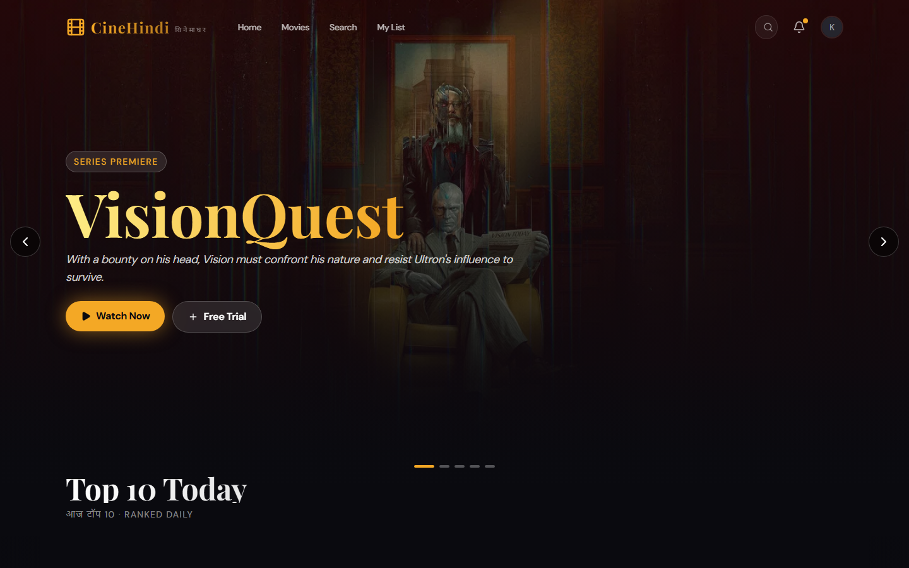
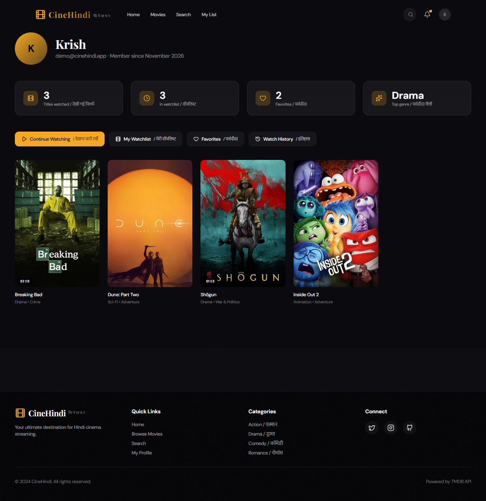
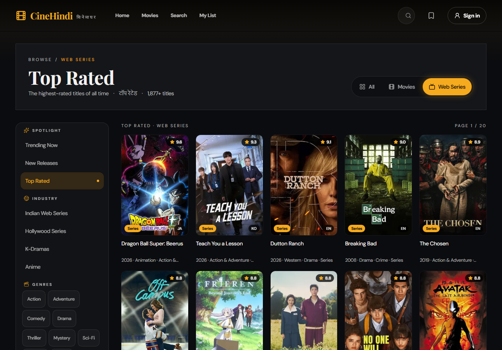
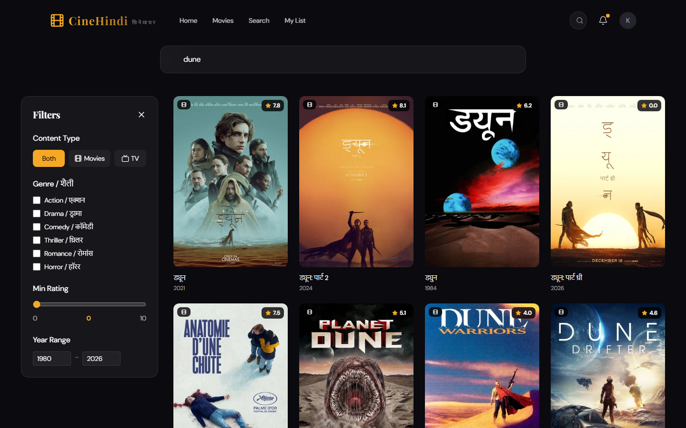
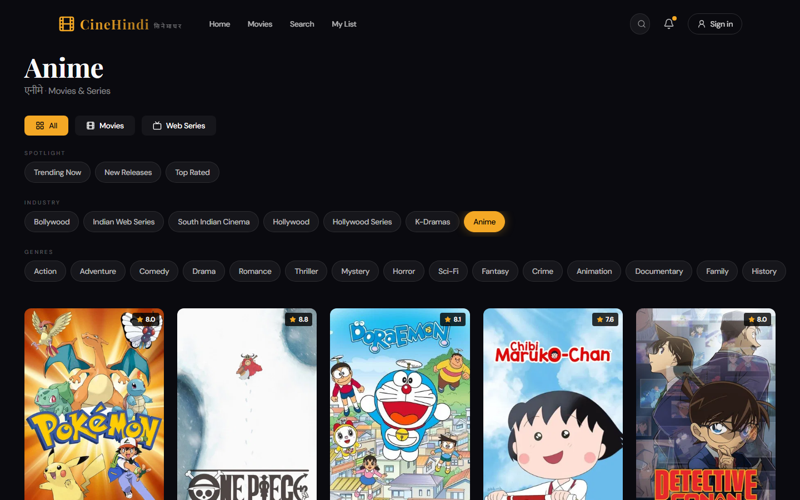
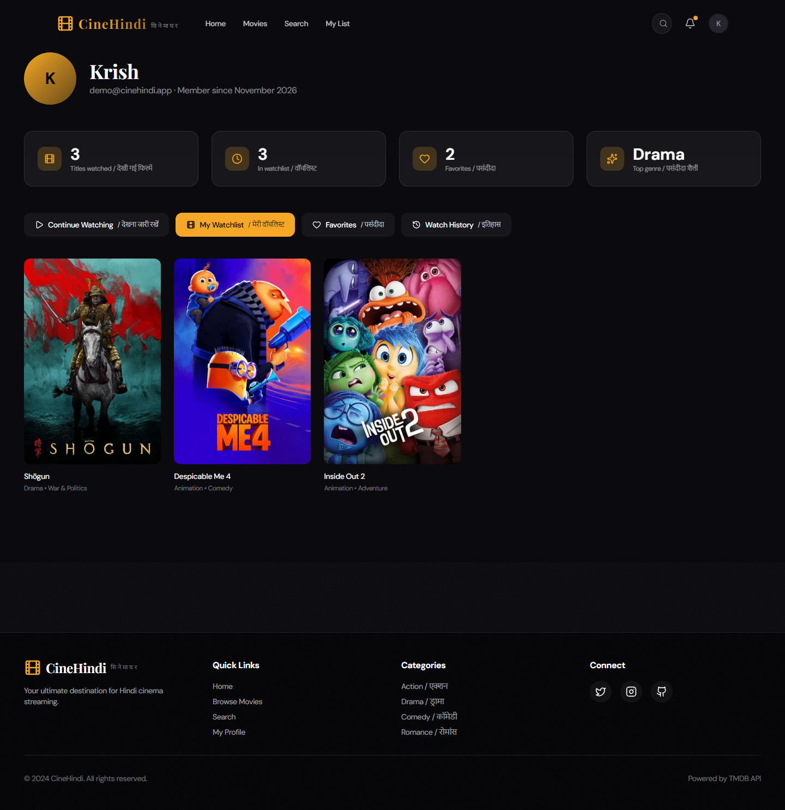
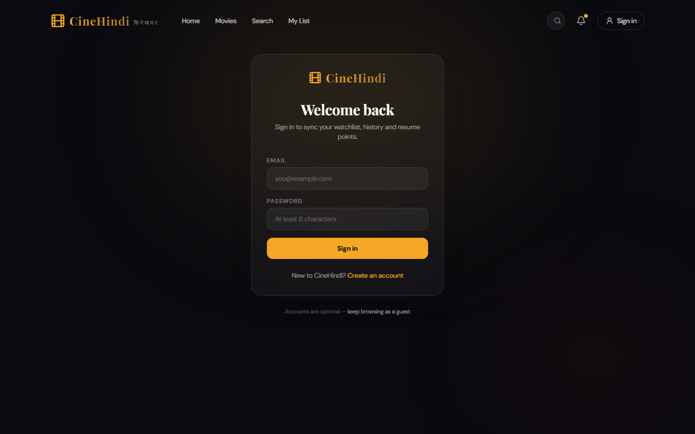

# CineHindi — Movie & TV Discovery App


> **CineHindi** is a movie and TV series discovery app — browse Bollywood, South Indian, Hollywood, K-dramas, anime and Indian web series, build a watchlist, get personal recommendations, and resume where you left off. Guest-first: no signup needed.

**Live site: [cine-hindi.vercel.app](https://cine-hindi.vercel.app)**

_This repository is named Movix; the app itself is called CineHindi._



## What it does

CineHindi is a streaming-style catalogue built on top of TMDB. You can browse and watch without an account; signing in is optional and unlocks a persistent library across devices.

- **Guest-first** — no signup wall. Watch history, likes and watchlist are saved locally so recommendations and the profile page still work.
- **Optional accounts** — email/password auth via Supabase. Your guest library is merged into the account on first sign-in.
- **Cloud sync** — watch history, watchlist, favorites and resume points stay in sync with Postgres + row-level security.
- **Resume where you left off** — TV shows remember the last season and episode you opened and jump straight back to it.
- **Personal recommendations** — “For You” and “Because You Watched …” rows built from genre affinity, recency decay and language preferences.
- **28 curated categories** — Bollywood, South Indian, Indian web series, Hollywood, K-dramas, anime, plus 18 genres across movies and series, with shareable deep links like `/browse?category=anime&type=all`.
- **Multi-server playback** — HLS-capable player with several embed fallbacks and per-server hints.
- **Discovery UI** — ranked rows, carousels, genre pages, live search with filters.

## Screenshots

| Movie detail | TV resume |
| --- | --- |
|  |  |



<details>
<summary>More screenshots</summary>

| Browse | Search |
| --- | --- |
|  |  |

| Anime — all media | Home category rows |
| --- | --- |
|  |  |

| Profile — watchlist | Sign in |
| --- | --- |
|  |  |


</details>

## How accounts work

| Layer | Guest | Signed in |
| --- | --- | --- |
| Library storage | `localStorage` (device only) | Supabase Postgres |
| Recommendations | Local history + likes | Cloud history hydrated into the local store |
| Resume | — | `playback` table (title + season/episode) |
| First sign-in | — | Guest rows are merged into the account; existing cloud rows win |

Cloud writes are fire-and-forget, so browsing never waits on the network. Row-level security policies restrict every table to `auth.uid()`, and a database trigger creates a profile row on signup.

> **Note:** playback runs through third-party iframe servers, so resume is tracked at the **episode level**, not to the exact second. The schema is ready for position-based resume when a player exposes playback events.

## Tech stack

| Area | Choice |
| --- | --- |
| Framework | Next.js 14 (App Router, Route Handlers) |
| Language | TypeScript |
| Styling | Tailwind CSS, shadcn-style primitives |
| Animation | Framer Motion |
| Auth & database | Supabase (Auth, Postgres, RLS) |
| Content | TMDB API |
| Playback | HLS.js + multi-server embeds |
| Deployment | Vercel |

## Getting started

```bash
git clone https://github.com/akyourowngames/Movix.git
cd Movix
npm install
cp .env.example .env.local
```

Fill in `.env.local`:

```env
NEXT_PUBLIC_SUPABASE_URL=https://your-project.supabase.co
NEXT_PUBLIC_SUPABASE_ANON_KEY=your-publishable-or-anon-key
NEXT_PUBLIC_TMDB_KEY=your-tmdb-v3-api-key
NEXT_PUBLIC_TMDB_READ_TOKEN=your-tmdb-v4-read-token
```

```bash
npm run dev
```

Open [http://localhost:3000](http://localhost:3000).

The TMDB key is required. The Supabase pair is optional — without it the app runs in guest-only mode and the auth screens show a configuration notice.

### Supabase setup

1. Create a project at [supabase.com](https://supabase.com).
2. Run [`supabase/migrations/20261115000000_user_library.sql`](./supabase/migrations/20261115000000_user_library.sql) in the SQL editor (or `supabase db push`). This creates `profiles`, `watch_history`, `watchlist`, `likes`, `playback`, RLS policies, indexes and the signup trigger.
3. In **Authentication → URL Configuration**, set the Site URL to your deployed domain and add redirect URLs:
   - `http://localhost:3000/auth/callback`
   - `https://your-domain.com/auth/callback`
4. **Email confirmation** is on by default. Either keep it and update your email template, or disable it under **Auth → Providers → Email** for instant sign-in.
5. Copy the project URL and anon/publishable key into `.env.local` (and into your Vercel project settings).

### Deploy

Import the repo into Vercel, add the four environment variables, and redeploy. No database connection string is required in the app — all access goes through the Supabase client with RLS.

## Project structure

```text
src/
  app/                    routes (browse, search, detail, profile, login, signup)
  app/api/                TMDB proxy routes and recommendations
  components/             player, cards, auth, navigation, personal rows
  hooks/useLocalProfile   guest library store (localStorage + listeners)
  lib/categories.ts       curated categories shared by browse UI and API
  lib/cloud.ts            cloud reads/writes, merge-on-sign-in, resume lookup
  lib/supabase/           browser client, server client, middleware, DB types
  lib/recommend.ts        scoring engine for personalized rows
supabase/migrations/      SQL schema + RLS policies
public/screenshots/       README assets
```

## Roadmap

- [ ] Position-based resume once a playback source exposes time events
- [ ] Profile editing and avatar uploads
- [ ] OAuth providers (Google, GitHub)
- [ ] Tests for auth, sync merge and resume selection
- [ ] Player keyboard shortcuts and subtitle preferences

## Author

Built by [Krish](https://github.com/akyourowngames). If this project helped you or sparked an idea, consider starring the repo.
