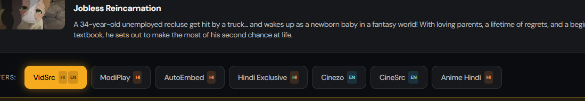
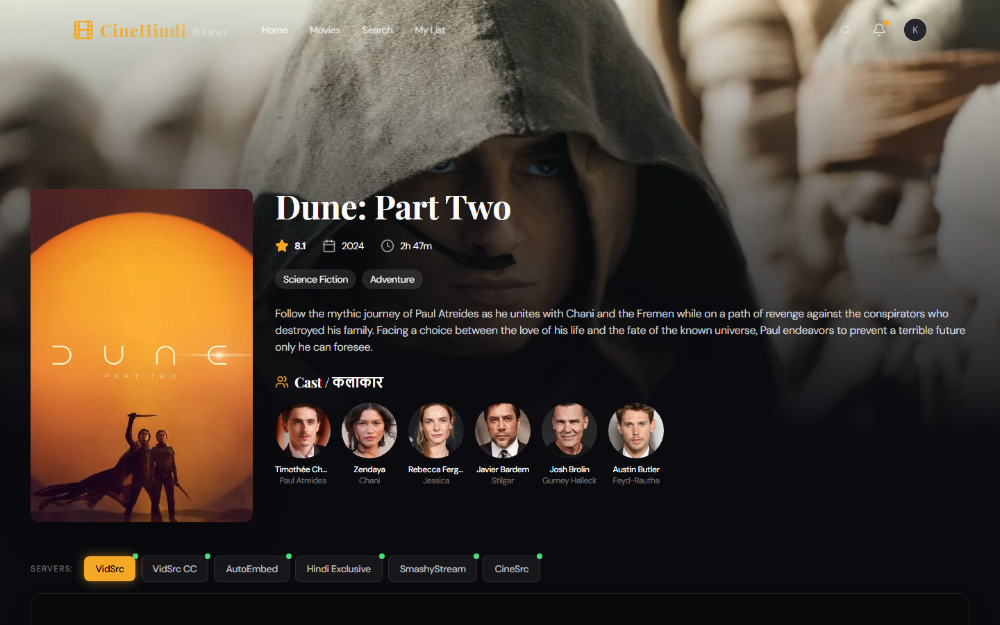
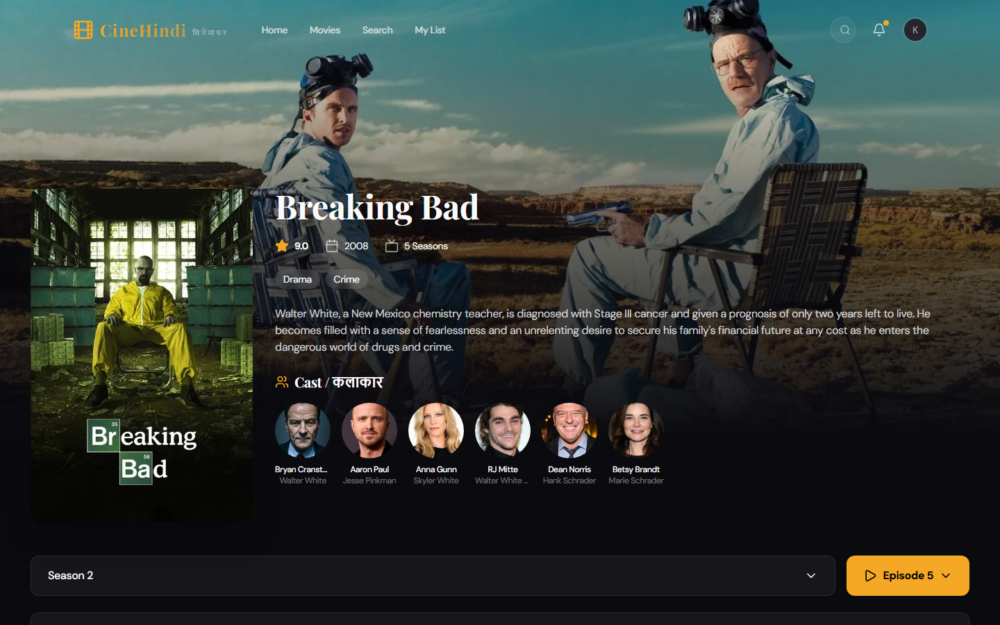
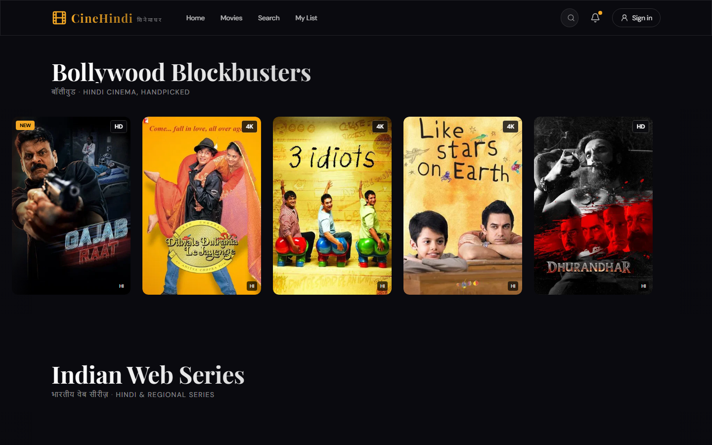
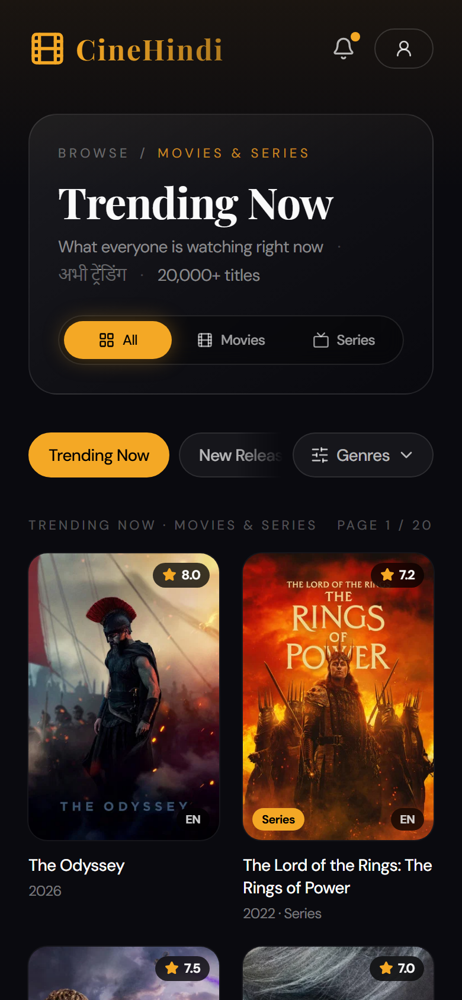
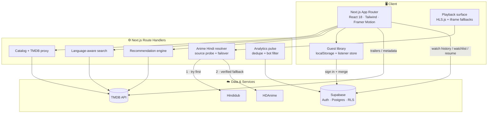

<p align="center">
  
</p>

<h1 align="center">🎬 CineHindi</h1>

<p align="center">
  <b>Discover. Watchlist. Resume. Repeat.</b><br/>
  A cinematic movie &amp; web-series discovery app with Hindi-first anime failover,
  synced libraries, resumes, trailers and personal recommendations.
</p>

<p align="center">
  <a href="https://cine-hindi.vercel.app">
    
  </a>
  <a href="https://github.com/akyourowngames/Movix/stargazers">
    
  </a>
  <a href="https://github.com/akyourowngames/Movix/network/members">
    
  </a>
</p>

<p align="center">
  
  
  
  
  
  
  
  
</p>

<p align="center">
  
  
  <a href="https://cine-hindi.vercel.app"></a>
</p>

---

## ✨ Why CineHindi?

CineHindi is **guest-first**: open it and start watching. No signup wall, no empty dashboard. If you want your library everywhere, sign in and your local history, likes, watchlist and resume points merge into Supabase.

It was built around one idea: **discovery should feel cinematic, and playback should fail over quietly**.

- 🎯 **Hindi-first discovery** — Bollywood, South Indian, Indian web series, Hollywood, K-dramas and anime in one catalogue.
- 🍿 **One-button Hindi anime** — the **Anime Hindi** server tries Hindidub first, verifies the source, then falls back to HDAnime automatically.
- 🔁 **Multi-server playback** — HLS.js + embed fallbacks with per-server hints and mobile-friendly defaults.
- 📺 **Episode resume** — TV pages remember the last season and episode you opened.
- 🧠 **Personal recommendations** — “For You” and “Because You Watched …” rows built from genre affinity, recency and language preference.
- 🎞️ **YouTube trailers** — official trailer modal with language chips and a clean in-app player.
- 🌐 **Hindi / English search** — language-aware TMDB queries that keep Japanese and Devanagari titles out of the wrong UI.
- 🔐 **Real accounts, real sync** — Supabase Auth, Postgres and row-level security.
- 📊 **Live analytics** — active users, total accounts, anonymous visitors and pageviews, with dedupe.
- 🚀 **SEO built in** — canonical URLs, Open Graph/Twitter images, JSON-LD, sitemap and robots rules.

> **Live:** [cine-hindi.vercel.app](https://cine-hindi.vercel.app)  
> **Repo:** [github.com/akyourowngames/Movix](https://github.com/akyourowngames/Movix)

---

## 📸 Screenshots

<p align="center">
  
</p>

| 🎬 Anime Hindi server | 🎥 Movie detail |
| --- | --- |
|  |  |

| 📺 TV resume & episodes | 👤 Synced profile |
| --- | --- |
|  |  |

<details>
<summary><b>🖼️ More screenshots</b></summary>

| Browse | Search |
| --- | --- |
|  |  |

| Anime catalogue | Home categories |
| --- | --- |
|  |  |

| Watchlist | Sign in |
| --- | --- |
|  |  |

<p align="center">
  
</p>

</details>

---

## 🧭 Architecture



### 🗂️ Project organization

```text
src/
├── app/
│   ├── page.tsx                 # cinematic home
│   ├── browse/                  # category + genre rows
│   ├── search/                  # live search (Hindi / English)
│   ├── movie/[id]/              # movie detail + trailer + player
│   ├── tv/[id]/                 # seasons, episodes, resume + player
│   ├── profile/                 # library, watchlist, likes
│   ├── admin/analytics/         # live analytics dashboard
│   └── api/
│       ├── anime-hindi/         # one-button Hindi anime resolver
│       ├── catalog/             # TMDB catalogue
│       ├── search/              # language-aware search
│       ├── recommend/           # personal recommendations
│       ├── season/              # episode lists
│       └── pulse/               # first-party analytics
├── components/                  # player, cards, nav, auth, rows
├── lib/
│   ├── tmdb.ts                  # TMDB client + caching
│   ├── recommend.ts             # scoring engine
│   ├── hindiAnime.ts            # Hindidub → HDAnime failover
│   ├── safeUrl.ts               # public-URL / SSRF checks
│   ├── cloud.ts                 # Supabase reads/writes + merge
│   └── supabase/                # browser/server clients + DB types
├── hooks/useLocalProfile.ts     # guest library store
└── supabase/migrations/         # schema, RLS, analytics
```

---

## 🧰 Tech stack

| Layer | Choice |
| --- | --- |
| **Framework** | Next.js 14 — App Router + Route Handlers |
| **Language** | TypeScript 5 |
| **UI** | React 18, Tailwind CSS, shadcn-style primitives, Framer Motion |
| **Data** | TMDB API |
| **Auth & DB** | Supabase Auth, Postgres, row-level security |
| **Playback** | HLS.js, multi-source iframe fallbacks, Anime Hindi resolver |
| **Analytics** | First-party cookies + Supabase RPCs |
| **Deployment** | Vercel |

---

## 🚀 Getting started

```bash
git clone https://github.com/akyourowngames/Movix.git
cd Movix
npm install
cp .env.example .env.local
```

### Environment

```env
NEXT_PUBLIC_SITE_URL=http://localhost:3000
NEXT_PUBLIC_TMDB_KEY=your-tmdb-v3-api-key
NEXT_PUBLIC_TMDB_READ_TOKEN=your-tmdb-v4-read-token
NEXT_PUBLIC_SUPABASE_URL=https://your-project.supabase.co
NEXT_PUBLIC_SUPABASE_ANON_KEY=your-publishable-or-anon-key
```

TMDB is required. Supabase is optional — without it the app runs in guest-only mode.

```bash
npm run dev       # http://localhost:3000
npm run lint      # ESLint
npm run build     # production build
npm run start     # production server
```

### 🗄️ Supabase setup

1. Create a project at [supabase.com](https://supabase.com).
2. Apply the migrations in [`supabase/migrations/`](./supabase/migrations) (`supabase db push` or paste into the SQL editor).
3. In **Authentication → URL Configuration**, set the Site URL and add:
   - `http://localhost:3000/auth/callback`
   - `https://your-domain.com/auth/callback`
4. Copy the project URL and publishable/anon key into `.env.local` and Vercel.

The schema includes `profiles`, `watch_history`, `watchlist`, `likes`, `playback`, analytics tables, RLS policies and the signup trigger.

### ☁️ Deploy

Import the repo into Vercel, add the environment variables, and deploy. No database connection string is needed in the app — all access goes through Supabase with RLS.

---

## 🔌 API routes

| Route | Purpose |
| --- | --- |
| `GET /api/catalog` | Catalogue rows by category / type |
| `GET /api/search?q=&lang=hi\|en` | Language-aware TMDB search |
| `GET /api/season?tv=&season=` | Season episode list |
| `GET /api/recommend` | Personal recommendation scoring |
| `GET /api/anime-hindi?type=&tmdbId=&season=&episode=` | One-button Hindi anime resolver |
| `POST /api/pulse` | First-party analytics heartbeat |
| `GET /api/admin/analytics` | Admin analytics overview |

`/api/anime-hindi` tries **Hindidub** first, checks the top sources, then falls back to **HDAnime**. It caches results for five minutes, rate-limits requests, and only accepts public HTTPS embed URLs.

---

## 🔐 Security & reliability

- Supabase RLS keeps every user row scoped to `auth.uid()`.
- Auth callbacks validate the `next` path before redirecting.
- API routes are rate-limited; analytics heartbeats are deduped.
- The Hindi anime resolver validates public URLs and blocks private/internal hosts.
- Security headers: HSTS, `X-Content-Type-Options`, `X-Frame-Options`, Referrer-Policy and Permissions-Policy.
- Guest data lives in `localStorage`; account data is merged on first sign-in.

> Playback runs through third-party iframe providers. Resume is tracked at the **episode level**, not to the exact second.

---

## 📊 Analytics

The admin dashboard at [`/admin/analytics`](https://cine-hindi.vercel.app/admin/analytics) shows:

- 👥 Active users (5-minute / 30-minute windows)
- 🧑‍🤝‍🧑 Total accounts
- 🕵️ Anonymous visitors
- 📈 Pageviews and top pages
- ⏱️ Session heartbeats with idle cutoff and pageview dedupe

Analytics uses first-party HttpOnly cookies (`ch_vid`, `ch_sid`) instead of a third-party script.

---

## 🗺️ Roadmap

- [x] Guest-first local library
- [x] Optional Supabase accounts + cloud sync
- [x] Episode-level resume
- [x] Personal recommendation engine
- [x] YouTube trailers
- [x] Language-aware Hindi / English search
- [x] Hindi anime one-button failover
- [x] Live analytics dashboard
- [x] Security headers + rate limiting
- [ ] Position-based resume (waiting on player time events)
- [ ] OAuth providers (Google / GitHub)
- [ ] Automated tests for auth, sync merge and resume selection

---

## 📚 Docs

- [Account setup](./docs/ACCOUNT_SETUP.md)
- [SEO & launch playbook](./docs/SEO_OUTREACH.md)
- [Agent project notes](./docs/agent/STATE.md)

---

## 👤 Author

**Krish Verma** — [@akyourowngames](https://github.com/akyourowngames)

Full-stack developer. Built CineHindi end to end: product design, Next.js architecture, Supabase auth and sync, the recommendation engine, the Hindi anime resolver and the cinematic UI.

- 🐙 GitHub: [github.com/akyourowngames](https://github.com/akyourowngames)
- 💻 Source: [github.com/akyourowngames/Movix](https://github.com/akyourowngames/Movix)
- 🌐 Live: [cine-hindi.vercel.app](https://cine-hindi.vercel.app)
- ℹ️ About: [cine-hindi.vercel.app/about](https://cine-hindi.vercel.app/about)

<p align="center">
  <b>⭐ If CineHindi helped you or sparked an idea, star the repo.</b>
</p>
